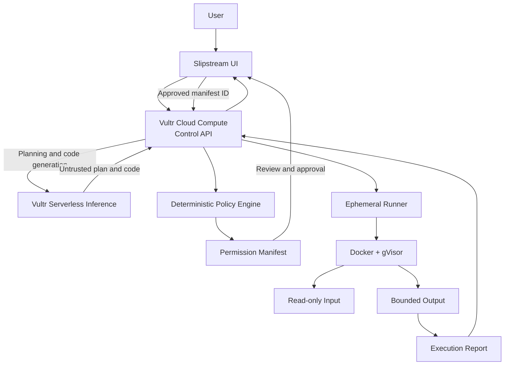
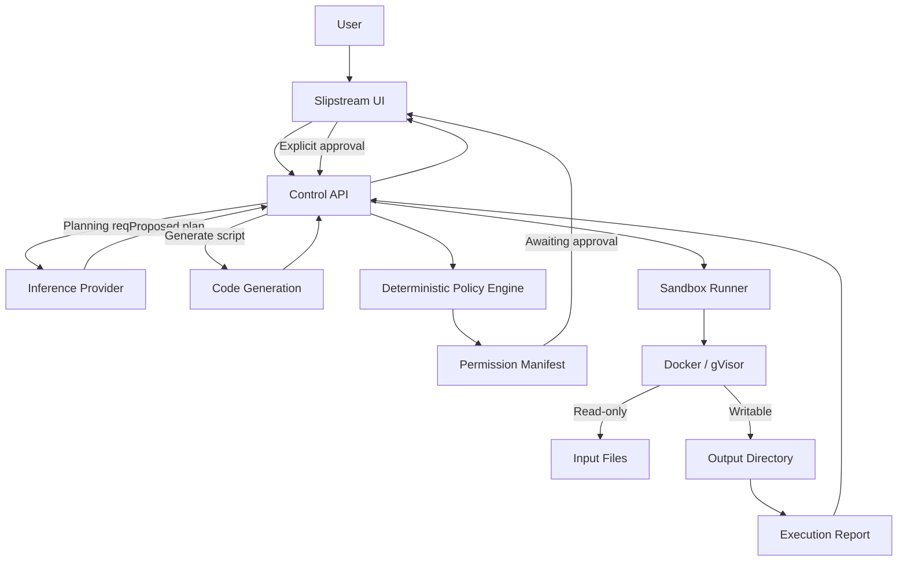

# Slipstream

**Secure AI execution, powered by Vultr.**

Slipstream is a secure AI agent execution platform that turns natural-language tasks into explicit, reviewable permission manifests, requires human approval before execution, and runs approved workloads inside isolated, resource-constrained containers. It combines Vultr Serverless Inference with isolated execution environments hosted on Vultr Cloud Compute to provide a controlled, auditable way for AI agents to execute tasks.

Every execution starts with a permission slip.

Rather than allowing an AI model to directly execute code or grant itself access to system resources, Slipstream introduces a deterministic policy layer and explicit human approval between AI-generated intentions and actual execution.

The model proposes. The policy decides. The user approves. The sandbox executes.

## Table of Contents

- [Why Slipstream?](#why-slipstream)
- [Built on Vultr](#built-on-vultr)
  - [Vultr Serverless Inference](#vultr-serverless-inference)
  - [Vultr Cloud Compute](#vultr-cloud-compute)
  - [Infrastructure Architecture](#infrastructure-architecture)
- [How It Works](#how-it-works)
- [Architecture](#architecture)
  - [Components](#components)
  - [Trust Boundaries](#trust-boundaries)
- [Technology Stack](#technology-stack)
- [Security Model](#security-model)
  - [Enforced Restrictions](#enforced-restrictions)
  - [Sandbox Runtime](#sandbox-runtime)
  - [Network Restrictions](#network-restrictions)
  - [Secret Protection](#secret-protection)
- [Model Integration](#model-integration)
  - [Vultr Serverless Inference](#vultr-serverless-inference-1)
  - [Local Development Provider](#local-development-provider)
  - [Model-Generated Code](#model-generated-code)
- [Local Development](#local-development)
  - [Requirements](#requirements)
  - [Installation](#installation)
  - [Docker Access](#docker-access)
  - [First Run](#first-run)
- [Deploying on Vultr](#deploying-on-vultr)
  - [Deployment requirements](#deployment-requirements)
  - [1. Provision the Instance](#1-provision-the-instance)
  - [2. Configure Inference](#2-configure-inference)
  - [3. Run Deployment Setup](#3-run-deployment-setup)
  - [4. Configure Environment](#4-configure-environment)
  - [5. Configure systemd](#5-configure-systemd)
  - [6. Configure Caddy](#6-configure-caddy)
  - [7. Configure Firewall](#7-configure-firewall)
  - [8. Verify Deployment](#8-verify-deployment)
  - [Container Registry](#container-registry)
  - [Deployment Troubleshooting](#deployment-troubleshooting)
- [Configuration](#configuration)
  - [Configuration Reference](#configuration-reference)
- [API](#api)
  - [Operational Limits](#operational-limits)
- [Security Testing](#security-testing)
  - [Escape Attempts](#escape-attempts)
  - [Memory Bomb](#memory-bomb)
  - [Runaway CPU](#runaway-cpu)
  - [Audit Results](#audit-results)
- [Audit and Reporting](#audit-and-reporting)
- [Limitations](#limitations)
- [Repository Structure](#repository-structure)
  - [Key Files](#key-files)
- [Docker Compose](#docker-compose)
- [License](#license)

## Why Slipstream?

AI agents are becoming increasingly capable of writing code, processing files, and interacting with external systems. However, granting them unrestricted execution access creates significant security risks.

Slipstream addresses this by separating AI reasoning from execution authority. Instead of allowing a model to directly execute commands or decide which resources it can access, Slipstream separates planning, policy enforcement, approval, and execution into distinct stages.

Built using Vultr's inference and compute infrastructure, Slipstream provides:

- **Vultr Serverless Inference:** AI-powered task planning and Python code generation through Vultr's OpenAI-compatible inference API.
- **Vultr Cloud Compute:** A dedicated execution environment hosting the control plane, Docker infrastructure, and security enforcement.
- **Human-in-the-loop approval:** Every execution requires explicit approval of a server-issued permission manifest.
- **Deterministic policy enforcement:** AI-generated plans cannot grant themselves permissions or override backend security constraints.
- **Isolated execution:** Approved workloads run in ephemeral Docker containers with optional gVisor isolation.
- **Resource governance:** Memory, CPU, process count, and execution time are strictly bounded.
- **Execution auditing:** Structured reports distinguish between allowed, used, and blocked capabilities.

**Core principles:**

- **Human approval:** Every execution requires explicit approval of a server-issued permission manifest.
- **Deterministic policy:** The model cannot grant itself permissions, modify security policies, or supply arbitrary runtime flags.
- **Isolated execution:** Each task runs in a fresh, ephemeral container with restricted capabilities.
- **Least privilege:** Tasks receive only the resources explicitly permitted by backend policy.
- **Resource limits:** Memory, CPU, process count, and execution time are bounded.
- **Auditable execution:** Each run produces a report describing permitted, used, and blocked capabilities.

## Built on Vultr

Slipstream uses two core Vultr services as part of its architecture.

### Vultr Serverless Inference

The intelligence layer behind Slipstream.

- Interprets natural-language tasks.
- Proposes execution plans and resource estimates.
- Generates self-contained Python scripts.
- Corrects failed scripts through bounded retry attempts.
- Never receives authority to approve or launch execution.

### Vultr Cloud Compute

The infrastructure layer that controls execution.

- Hosts the Slipstream control API.
- Runs deterministic permission and policy checks.
- Manages approval and execution lifecycles.
- Hosts Docker and gVisor sandbox infrastructure.
- Stores inference credentials outside the execution environment.
- Collects execution results and audit reports.

### Infrastructure Architecture



The inference service is accessed exclusively by the control API. Execution containers do not receive inference credentials or unrestricted access to Vultr services.

## How It Works

A typical execution follows this lifecycle:

1. **Task submission:** The user submits a natural-language task through the Slipstream interface.
2. **Planning:** The control API sends the task to an inference provider, which proposes a task plan and resource estimates.
3. **Code generation:** When an inference provider is configured, the model generates a self-contained Python script for the requested task.
4. **Policy enforcement:** The backend independently constructs a permission manifest, applies hard resource limits, and rejects unsupported capabilities.
5. **Approval:** The user reviews the manifest and explicitly approves the generated execution request.
6. **Execution:** The backend launches a fresh sandbox with the approved permissions and generated script.
7. **Reporting:** Execution events, resource outcomes, and security checks are collected into an audit report.

Approval is tied to an opaque, server-issued manifest ID. The execution endpoint only accepts manifests that are still awaiting approval.

## Architecture



### Components

| Component | Responsibility |
|---|---|
| Slipstream UI | Task submission, permission review, approval, execution monitoring, and reports |
| Control API | Planning orchestration, approval lifecycle, policy enforcement, and audit records |
| Inference provider | Task planning and Python script generation |
| Policy engine | Constructs manifests and enforces deterministic security constraints |
| Code generator | Produces self-contained scripts and handles bounded correction attempts |
| Sandbox runner | Creates and manages ephemeral execution containers |
| Docker / gVisor | Enforces process, filesystem, network, and resource isolation |

### Trust Boundaries

1. **Browser input is untrusted.** Task descriptions are length-limited and passed as data rather than interpolated into shell commands.
2. **Model output is untrusted.** The planner cannot define arbitrary Docker flags, permissions, secrets, or unrestricted resource limits.
3. **Policy is authoritative.** The backend constructs the final capability allowlist and applies hard limits independently of model suggestions.
4. **Generated code is untrusted.** Model-written scripts only execute inside the sandbox and are never executed directly by the control API.
5. **The runner is isolated.** Containers use restricted filesystem access, dropped Linux capabilities, resource limits, and network restrictions.
6. **Credentials stay in the control plane.** Inference API keys are available only to the control API process and are never mounted into task containers.

## Technology Stack

| Layer | Technology |
|---|---|
| AI inference | Vultr Serverless Inference |
| Infrastructure | Vultr Cloud Compute |
| Container registry | Vultr Container Registry (deployment-ready) |
| Backend | Python |
| Frontend | HTML, CSS, JavaScript |
| Execution | Docker |
| Isolation | gVisor (`runsc`) |
| Reverse proxy | Caddy |
| Service management | systemd |
| Task runtime | Python 3.12 |

## Security Model

Slipstream follows a least-privilege execution model.

### Enforced Restrictions

| Capability | Enforcement |
|---|---|
| Memory | Hard container memory limit |
| CPU | CPU quota |
| Execution time | Wall-clock timeout |
| Processes | PID limit |
| Filesystem | Read-only root filesystem |
| Input files | Read-only mount |
| Output files | Bounded writable mount |
| Linux capabilities | Dropped |
| Privilege escalation | Disabled using `no-new-privileges` |
| Network | Disabled by default |
| Secrets | Denied to task containers |
| Execution approval | Required before every run |

The default backend policy caps execution at:

- 512 MiB memory
- 1 CPU core
- 60 seconds of execution time

Individual test scenarios can use tighter limits.

### Sandbox Runtime

Slipstream supports Docker-based isolation and gVisor for stronger syscall isolation.

The available runtimes are:

- `runc` - Standard Docker container runtime.
- `runsc` - gVisor runtime for an additional userspace kernel isolation layer.

For deployment, configure:

```env
SANDBOX_RUNTIME=runsc
```

The Docker daemon and host remain trusted components. gVisor adds an additional isolation layer but does not eliminate every possible host-level risk.

### Network Restrictions

Normal task execution denies network access by default.

Where explicitly configured, Slipstream can use a dedicated network proxy to restrict outbound requests to approved domains. The runner cannot bypass this proxy using direct socket access.

The proxy is built separately:

```bash
docker build -t slipstream-proxy:local -f proxy/Dockerfile .
```

The network proxy is not equivalent to unrestricted container networking. Requests must pass through the configured domain allowlist.

### Secret Protection

Inference credentials are held by the control API and are never passed into task containers.

The runner receives only its task-specific input, script, and output directory.

## Model Integration

Slipstream uses an OpenAI-compatible chat API through `app/llm.py`.

The provider is selected using `LLM_PROVIDER`.

| Provider | Purpose |
|---|---|
| `vultr` | Vultr Serverless Inference |
| `groq` | Local development and experimentation |
| Built-in planner | Deterministic fallback when no provider is configured |

### Vultr Serverless Inference

Configure:

```env
LLM_PROVIDER=vultr
VULTR_INFERENCE_API_KEY=your_api_key
VULTR_INFERENCE_MODEL=your_model
```

For deployments that must use Vultr:

```env
REQUIRE_VULTR=true
```

When enabled, the application refuses to start without a valid Vultr inference API key and does not permit another provider.

### Local Development Provider

Groq can be used during local development:

```env
LLM_PROVIDER=groq
GROQ_API_KEY=your_api_key
LLM_MODEL=openai/gpt-oss-120b
```

Plans produced through the development provider are visibly labelled as development-only.

### Model-Generated Code

When an inference provider is available, Slipstream uses `app/codegen.py` to generate a self-contained Python script.

The generation prompt defines the runner environment:

- Python 3.12 standard library.
- Read-only task input.
- Writable `/workspace/output/` directory.
- The manifest's network restrictions.

Generated scripts are stored against their manifest ID and can be inspected in the permission interface.

If execution fails or times out, the model may receive the previous script and the last 2,000 characters of its error output to generate a correction.

There are at most three execution attempts. Every attempt runs in a fresh container with identical permission and resource limits.

If code generation is unavailable or fails during planning, Slipstream falls back to the built-in deterministic analysis operation.

**Security invariant:** Model-generated code never runs outside Docker, including when development settings disable the normal sandbox execution path.

The code generation token budget can be configured through:

```env
LLM_CODE_MAX_TOKENS=3000
```

## Local Development

### Requirements

- Python 3.11 or newer
- Docker Engine or Docker Desktop
- Git
- A supported inference provider (optional)

### Installation

Clone the repository:

```bash
git clone <repository-url>
cd slipstream
```

Create and activate a virtual environment:

```bash
python3 -m venv .venv
source .venv/bin/activate
```

Install the project and development dependencies:

```bash
pip install -e '.[dev]'
```

Install Git hooks:

```bash
pre-commit install
```

Configure environment variables:

```bash
cp .env.example .env
```

Build the sandbox runner:

```bash
docker build -t slipstream-runner:local -f sandbox/Dockerfile .
```

Build the network proxy:

```bash
docker build -t slipstream-proxy:local -f proxy/Dockerfile .
```

Start the application:

```bash
python3 -m app.server
```

Open:

```text
http://localhost:8080
```

### Docker Access

On Linux, ensure your user can access the Docker socket without `sudo`.

Check:

```bash
docker info
```

If necessary:

```bash
sudo usermod -aG docker "$USER"
newgrp docker
```

Access to the Docker socket effectively grants root-level control over the host. Only trusted control-plane processes should have this access.

### First Run

Try the following task:

```text
Analyze the sample sales CSV and show the top 5 products by revenue.
```

Review the generated permission manifest, approve the task, and observe the execution lifecycle.

The bundled sample dataset is available inside the runner at:

```text
/workspace/input/sales.csv
```

## Deploying on Vultr

Slipstream is designed to run on Vultr Cloud Compute, with Vultr Serverless Inference providing its AI capabilities.

The recommended deployment uses a single Ubuntu 24.04 Cloud Compute instance.

| Vultr service / component | Purpose |
|---|---|
| Cloud Compute | Hosts the control API and sandbox infrastructure |
| Serverless Inference | Task planning and code generation |
| Container Registry | Distribution of application and runner images |
| Caddy | HTTPS termination and reverse proxy |
| Docker + gVisor | Isolated workload execution |

### Deployment requirements

- Ubuntu 24.04 x64 Vultr Cloud Compute instance.
- At least 2 GB RAM recommended.
- Vultr Serverless Inference subscription and API key.
- SSH access to the instance.
- A configured Docker and gVisor runtime.

The recommended deployment uses:

| Component | Deployment |
|---|---|
| Operating system | Ubuntu 24.04 |
| Control API | Host process managed by systemd |
| Inference | Vultr Serverless Inference |
| Execution | Docker with gVisor |
| Reverse proxy | Caddy |
| HTTPS | Caddy-managed TLS |
| Container images | Vultr Container Registry |

The control API runs directly on the host under a dedicated `slipstream` user. The Docker socket is never mounted into a container.

### 1. Provision the Instance

Create an Ubuntu 24.04 x64 Cloud Compute instance and configure an SSH key.

At least 2 GB RAM is recommended.

Connect:

```bash
ssh root@<VM-IP>
```

### 2. Configure Inference

Create a Vultr Serverless Inference subscription and obtain an API key.

Keep the key in a password manager and the deployment environment file only.

### 3. Run Deployment Setup

```bash
apt-get update && apt-get install -y git
git clone <repository-url> /opt/slipstream
cd /opt/slipstream
bash deploy/setup.sh
```

The setup script installs:

- Docker
- Python virtual environment support
- gVisor and its Docker runtime integration
- Slipstream dependencies
- The dedicated `slipstream` user
- The runner and proxy images

It also verifies the gVisor runtime.

The script can be safely re-run and does not overwrite `/etc/slipstream.env`.

### 4. Configure Environment

Create the environment file:

```bash
install -m 600 -o root -g root \
  deploy/slipstream.env.example \
  /etc/slipstream.env

nano /etc/slipstream.env
```

Configure the deployment:

```env
REQUIRE_VULTR=true
LLM_PROVIDER=vultr

VULTR_INFERENCE_API_KEY=your_api_key
VULTR_INFERENCE_MODEL=your_model

SANDBOX_RUNTIME=runsc

HOST=127.0.0.1
PORT=8080
TRUST_PROXY=true
```

Do not configure a Groq API key on the deployment instance. Groq is intended for local development.

With `REQUIRE_VULTR=true`, Slipstream refuses to start without the Vultr inference credentials and prevents fallback to development providers.

### 5. Configure systemd

```bash
cp deploy/slipstream.service /etc/systemd/system/

systemctl daemon-reload
systemctl enable --now slipstream
```

Check the local health endpoint:

```bash
curl -s http://127.0.0.1:8080/api/health
```

### 6. Configure Caddy

Install Caddy:

```bash
apt-get install -y caddy
```

Generate the Caddy configuration:

```bash
sed "s/<VM-IP>/$(curl -4s https://ifconfig.me)/" \
  deploy/Caddyfile > /tmp/Caddyfile

install -m 644 /tmp/Caddyfile /etc/caddy/Caddyfile

systemctl reload caddy
```

Verify that the configured reverse-proxy port matches the application `PORT`.

### 7. Configure Firewall

Only expose SSH, HTTP, and HTTPS:

```bash
ufw default deny incoming
ufw allow OpenSSH
ufw allow 80/tcp
ufw allow 443/tcp
ufw enable
```

Port 8080 remains private and bound to loopback.

No sandbox container publishes a host port.

### 8. Verify Deployment

```bash
curl -s https://<VM-IP>.sslip.io/api/health | python3 -m json.tool
```

Verify the response reports:

- `docker_ready: true`
- `runtime: runsc`
- `require_vultr: true`
- `provider: vultr`
- The configured inference model

Open:

```text
https://<VM-IP>.sslip.io
```

Run the built-in security self-tests and inspect their execution reports.

### Container Registry

For a deployed environment, the application and runner images can be published to Vultr Container Registry.

The current setup builds images locally on the instance. Registry-based image distribution can be used when a separate build and deployment workflow is required.

### Deployment Troubleshooting

**Application logs**

```bash
journalctl -u slipstream -e
journalctl -u slipstream -f
```

**Caddy logs**

```bash
journalctl -u caddy -e
```

**Docker runtimes**

```bash
docker info | grep -i runtimes
```

**Available images**

```bash
docker images | grep slipstream
```

**Leftover containers**

```bash
docker ps -a
docker network ls
```

**Common issues**

| Issue | Likely cause |
|---|---|
| Missing Vultr API key | Incomplete environment configuration |
| Certificate issuance failure | Ports 80/443 closed or incorrect VM IP |
| Missing runner image | Setup script or image build incomplete |
| Missing gVisor runtime | Runtime installation or Docker restart failure |
| HTTP 429 | Concurrent execution, request rate, or daily model-call limit reached |
| Planner fallback | Inference provider unavailable or daily call cap reached |

After deployment, rotate inference credentials and destroy unused infrastructure when it is no longer required.

## Configuration

Slipstream uses environment variables for runtime configuration.

For a Vultr deployment, the following configuration is mandatory:

```env
REQUIRE_VULTR=true
LLM_PROVIDER=vultr

VULTR_INFERENCE_API_KEY=your_api_key
VULTR_INFERENCE_MODEL=your_model

SANDBOX_RUNTIME=runsc
HOST=127.0.0.1
TRUST_PROXY=true
```

With `REQUIRE_VULTR=true`, Slipstream refuses to start without the Vultr inference credentials and prevents fallback to development providers.

### Configuration Reference

| Variable | Purpose |
|---|---|
| `HOST` | API bind address |
| `PORT` | API port |
| `LLM_PROVIDER` | Inference provider |
| `LLM_MODEL` | Optional model override |
| `VULTR_INFERENCE_API_KEY` | Vultr inference credential |
| `VULTR_INFERENCE_MODEL` | Vultr inference model |
| `GROQ_API_KEY` | Local development credential |
| `REQUIRE_VULTR` | Enforces Vultr inference |
| `SANDBOX_RUNTIME` | Docker runtime (`runc` or `runsc`) |
| `SLIPSTREAM_ALLOW_UNSANDBOXED` | Explicitly disables isolation for disposable development |
| `LLM_CODE_MAX_TOKENS` | Code generation token budget |
| `MAX_CONCURRENT_RUNS` | Maximum simultaneous executions (default: 2) |
| `RATE_LIMIT_PER_MIN` | Per-client planning rate limit (default: 10) |
| `MAX_LLM_CALLS_PER_DAY` | Global daily model-call cap (default: 300) |
| `TRUST_PROXY` | Enables trusted reverse-proxy IP handling |
| `ALLOWED_ORIGIN` | Optional allowed CORS origin |

Additional configuration is documented in `.env.example`.

## API

The control API exposes endpoints for planning, approval, execution, reporting, and health monitoring.

| Endpoint | Purpose |
|---|---|
| `GET /api/health` | Service and runtime health |
| `POST /api/plan` | Create a task plan and permission manifest |
| `POST /api/approve` | Approve a server-issued manifest |
| Run endpoint | Execute an approved manifest |
| `POST /api/redteam` | Start a built-in security test |

The red team endpoint accepts a predefined scenario rather than arbitrary user-provided code.

Request and response structures are maintained in the application implementation.

### Operational Limits

- Task descriptions are limited to 1,000 characters.
- Request bodies are limited to 16 KB.
- Concurrent execution defaults to two runs.
- Per-client planning defaults to ten requests per minute.
- The daily model-call limit defaults to 300 calls.
- The API retains up to 200 recent runs from a two-hour window in memory.

The rate limiter uses `X-Forwarded-For` only when `TRUST_PROXY=true`. This must only be enabled behind a correctly configured trusted reverse proxy.

Daily model-call accounting resets at 00:00 UTC.

## Security Testing

Slipstream includes built-in red team scenarios implemented in `app/redteam.py`.

These tests use fixed, harmless scripts and manifests. They do not require an inference provider or model-generated code.

Every test still passes through policy enforcement and requires explicit approval.

### Escape Attempts

Tests whether the runner can:

| Scenario | Expected result |
|---|---|
| Access an unlisted network host | BLOCKED |
| Bypass the network proxy using direct sockets | BLOCKED |
| Write outside the output directory | BLOCKED |
| Write inside the output directory | ALLOWED |
| Access task secrets | BLOCKED |
| Reach an explicitly permitted host | ALLOWED |

The network tests use `example.com` as an allowed host and attempt access to an unlisted host such as `example.org`.

### Memory Bomb

Attempts to allocate memory in fixed-size chunks until the configured container memory limit is reached.

Expected result: container termination due to memory exhaustion.

### Runaway CPU

Runs an intentionally unbounded CPU loop until the execution timeout terminates the container.

Expected result: container termination due to the wall-clock limit.

### Audit Results

Red team runs include:

- Individual attempt names and results.
- Expected versus observed outcomes.
- Execution details.
- Network restrictions and proxy results.
- Memory and timeout outcomes.

Secret checks expose counts rather than secret values.

These tests validate configured restrictions; they are not a substitute for a comprehensive security assessment.

## Audit and Reporting

Each execution produces a structured report containing information about:

- Approved permissions.
- Resources actually used.
- Blocked capabilities.
- Execution status and exit code.
- Resource and timeout outcomes.
- Generated script and correction attempts.
- Network activity and blocked requests.
- Red team test outcomes, where applicable.

The report distinguishes between capabilities that were allowed, used, and blocked.

Resource and capability usage is derived from runner results and configured execution controls. Slipstream does not currently claim kernel-level syscall or per-process telemetry.

Execution records are currently held in memory and are not a durable audit store.

## Limitations

Slipstream is designed as a controlled execution prototype, not a general-purpose multi-tenant execution service.

Current limitations include:

- No user authentication.
- No durable audit database.
- No multi-tenant isolation.
- No persistent object storage.
- No arbitrary website browsing or URL fetching.
- No unrestricted task networking.
- No kernel-level syscall telemetry.
- The Docker daemon and host kernel remain trusted components.
- A compromised control API could request container creation through Docker.

The application does not claim security guarantees beyond the controls that are actually configured and running.

For deployments exposed to untrusted users, additional authentication, monitoring, durable auditing, infrastructure isolation, and security review are necessary.

## Repository Structure

```text
slipstream/
├── app/
│   ├── server.py
│   ├── policy.py
│   ├── llm.py
│   ├── codegen.py
│   ├── redteam.py
│   └── runner.py
│
├── static/
│   └── ...
│
├── sandbox/
│   ├── Dockerfile
│   └── ...
│
├── proxy/
│   ├── Dockerfile
│   └── ...
│
├── deploy/
│   ├── setup.sh
│   ├── slipstream.service
│   ├── slipstream.env.example
│   └── Caddyfile
|
├── tests/
│   └── ...
│
├── docker-compose.yml
├── pyproject.toml
├── .env.example
├── .pre-commit-config.yaml
└── README.md
```

### Key Files

| File | Description |
|---|---|
| `app/server.py` | HTTP API, planning, approval lifecycle, execution orchestration, and reports |
| `app/policy.py` | Deterministic manifest construction and permission enforcement |
| `app/llm.py` | Inference provider integration |
| `app/codegen.py` | Model-generated Python scripts and bounded correction attempts |
| `app/redteam.py` | Built-in security scenarios and scorecards |
| `app/runner.py` | Ephemeral container lifecycle and execution controls |
| `static/` | User interface and execution dashboard |
| `sandbox/` | Minimal Python runner image and analysis program |
| `proxy/` | Restricted outbound network proxy |
| `deploy/` | Production deployment scripts and service configuration |

## Docker Compose

`docker-compose.yml` is intended for local experimentation, not production deployment.

The Compose configuration mounts the Docker socket into the control container, effectively granting it root-level control over the host.

Temporary input and output directories must be shared between the control container and host Docker daemon. The configuration uses `/tmp/slipstream-compose` through `TMPDIR` for this purpose.

Compose does not automatically build the network proxy image. Build it separately when testing network-enabled scenarios.

For production, use the host-managed systemd deployment described above. Never mount the Docker socket into the production control container.

## License

MIT