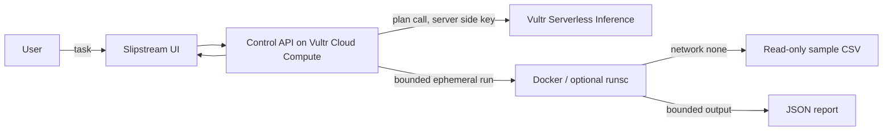

# Architecture

The inference model proposes task intent and resource estimates. It cannot launch a run or grant itself capabilities. The API replaces model access requests with a task-specific capability template, applies hard caps, and issues an opaque manifest ID. Only an explicit approval for that ID starts execution. The runner image includes only Python and the CSV program. Input is mounted read-only; output is mounted writable; the container receives no network and no host secrets.

The demo uses Vultr Serverless Inference for the planning call and is designed to run on Vultr Cloud Compute. Publish the app and runner images to Vultr Container Registry for a deployed demo. Object Storage is deliberately deferred: the current result is a small JSON artifact, and adding persistent storage would widen the permissions without improving this demo. No cloud feature is claimed as active unless configured and running.

## Trust boundaries

1. Browser input is untrusted. It is length limited and never interpolated into a shell command; it is passed as a single argument to the fixed analysis program.
2. The planner response is untrusted. Policy constructs the final allowlist locally and never accepts arbitrary Docker flags.
3. The runner is isolated by Docker controls. For stronger syscall isolation, deploy gVisor (`runsc`) and set `SANDBOX_RUNTIME=runsc`.
4. Inference credentials are read only by the control API process. They are not mounted in the runner.

## Current scope and gaps

The demo currently supports a bundled CSV and one fixed analysis operation. It does not fetch arbitrary URLs, browse websites, or execute model-generated code. The `used` report is derived from the runner result and configured mounts/limits; it does not yet collect kernel-level syscall or per-process resource telemetry. The blocked-attempt list is empty because this constrained workload has no network or shell capability to attempt. These limits are presented explicitly in the UI and report.
